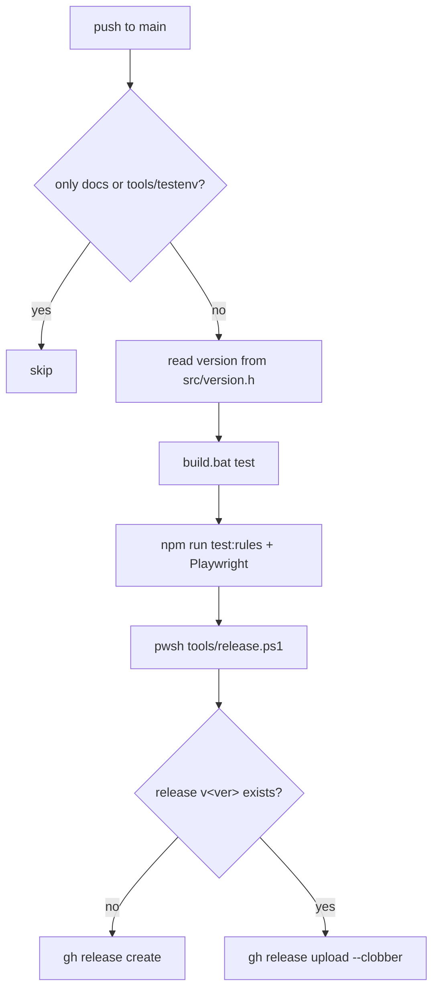

# 11. Build, test, release

Wind builds with one batch script, tests with a desktop-free doctest binary plus a Playwright
suite for the settings UI, and ships an NSIS installer that GitHub Actions rebuilds on every push
to `main`. This chapter covers the build targets, the pure/Win32 test split, the local UIAccess
deploy, the installer's elevation rules and the release workflows.

## build.bat targets

`build.bat` locates MSVC with vswhere, runs `vcvars64.bat` and dispatches on its first argument.
**Nothing is written to the repo root.** Binaries and their linker PDBs go to `build\`, which is
laid out like an install (`Wind.exe`, `WindTray.exe`, `WindConfig.exe` and `ui\dist` side by side,
so `ExeDir()` lookups work unchanged). Objects, compiler PDBs and `.res` files go to
`build\obj\<target>\` (`wind`, `wind_uiaccess`, `tray`, `config`, `test`, `check\*`): targets
compile the same sources with different defines, and the tray and settings hosts each have a
`main.cpp`. The working directory stays the repo root.

| Target | Output | What it is |
|---|---|---|
| (none) | `build\Wind.exe` + `build\WindTray.exe` | The app with the `uiAccess=false` manifest. It refuses to start without UIAccess (issue #460) unless `WIND_ALLOW_NO_UIACCESS=1` or `WIND_SELFTEST=1` is set |
| `test` | `build\wind_tests.exe` | The doctest binary over the pure sources; runs it from the repo root (it finds `tests\fixtures` there) and returns its exit code |
| `check` | – | Compile-only pass over Wind.exe's sources (`CORE_SRC`), `src\tray_app\*.cpp` and `src\config_ui\main.cpp`, objects in `build\obj\check\` |
| `uiaccess` | `build\Wind.exe` + `build\WindTray.exe` | `Wind.uiaccess.manifest` and `/DWIND_UIACCESS`; useful only signed and in Program Files. `WindTray.exe` always keeps the plain manifest |
| `tray` | `build\WindTray.exe` | The tray helper alone |
| `config` | `build\WindConfig.exe` | Builds the Svelte app to `ui/dist/`, then the WebView2 host against `third_party/webview2`, then mirrors `ui\dist` to `build\ui\dist` (the host loads `<exe dir>\ui\dist`) |
| `installer` | `dist\Wind-Setup-x64-<ver>.exe` | `makensis /WX installer\wind.nsi` (packs `build\*.exe` and `ui\dist`), then `tools\installer_check.ps1` |

**A dev build's runtime files live in `build\`.** `build\` is writable, so `ResolveIniPath()` and
`ResolveLogDir()` keep a dev build's `magnifier.ini`, `profiles\` and `logs\` next to
`build\Wind.exe`, as they did at the root before. Deleting `build\` deletes them too; an ini left at
the root by an older clone is no longer read (move it into `build\` to keep it). A self-test writes
`wind_selftest.png` and `wind_hdr_diag.txt` to its working directory, so
`WIND_SELFTEST=1 build\Wind.exe` from the repo root leaves them at the root (gitignored).

The installer treats NSIS warnings as errors: an unreferenced define in generated layout data is
how a page ends up wired to nothing.

## Source folders and includes

`src\` is grouped by area, one folder per row of the source map in [01](01-overview.md#source-map):
`core`, `engine`, `render`, `transform`, `color`, `input`, `cursor`, `track`, `zoom`, `config`, `tray`,
`platform`, plus `tray_app` and `config_ui`. `wind.rc`, `resource.h` and `version.h` stay in `src\`
itself, where `tools\version.ps1`, `installer\wind.nsi` and `ui/vite.config.js` read the version.

**A Wind header is always included by its bare file name** (`#include "config.h"`, never
`"../config.h"` or `"../src/config/config.h"`), from `src\` and `tests\` alike. `build.bat` puts every
src folder on every compile's include path (`WIND_INC`) and lists Wind.exe's source folders once
(`CORE_SRC`). A new folder goes into `WIND_INC`, and into `CORE_SRC` when it holds Wind.exe sources.
Header file names must stay unique across `src\`. The `.rc` files are the exception: rc.exe gets no
include path, so `src\tray_app\wind_tray.rc` reaches `resource.h` and `version.h` through `..\`.

## Pure versus Win32

**Anything with real logic compiles without `<windows.h>`.** The magnifier cannot be driven
headlessly, so the unit tests are the only verification loop that runs everywhere, including CI.

- The `test` target compiles `tests\*.cpp` with `/DWIND_TESTS` against only the pure sources. The
  authoritative list is the `:test` target in `build.bat`; today it is `transform`,
  `zoom_controller`, `config`, `profiles`, `cursor_mapper`, `lock_detector`, `cursor_lock`,
  `crosshair`, `ini_edit`, `logging`, `tray_items`, `hitch_record`, `render_params` and
  `tray_app/tray_pin_logic`.
- Header-only pure modules (`engine_pick.h`, `drag_follow.h`, `hdr_scale.h`, `keybind_rules.h`,
  `config_ui/wind_watchdog.h`, `config_ui/bridge_json.h`, `swallow_ledger.h`, `reload_gate.h` and others) ride in through their test files.
- One test file per module (`tests/test_<module>.cpp`). A new pure `.cpp` also goes into the
  `:test` list.
- Files that straddle the line put their OS half under `#ifndef WIND_TESTS`. `src/config/config.cpp` is
  the example: `ParseConfig` and `StripUiOnlyKeys` above, `LoadConfig` and the only
  `#include <windows.h>` below.
- Thin header-only Win32 I/O layers may be tested too, from a test file that includes
  `<windows.h>` itself: `tests/test_profiles_io.cpp` exercises `src/config/profiles_io.h` against real
  temp files. They need no Wind runtime, so they still run headless.
- `tests/fixtures/keybind_cases.txt` is shared by the C++ and the JavaScript bind rules. The JS half
  is `ui/tests/keybind-rules.nodetest.mjs`, run by `npm run test:rules` in `ui/` (`node --test`, no
  browser) and by CI. `tests/fixtures/global_keys.txt` does the same for the profile-global keys
  (`ui/tests/global-keys.nodetest.mjs`).
- Config defaults are checked from both sides. `tests/test_config_defaults.cpp` walks every key of
  `DefaultIniText()` against `Config{}` (a new template key needs an `F(key)` line there) and compares
  `tests/fixtures/config_defaults.txt` (key, clamp min and max, default; generated from `Config{}` and
  `ParseConfig`) with what the build computes. `ui/tests/config-defaults.nodetest.mjs` (also in
  `npm run test:rules`) checks the Settings schema's defaults and slider ranges against that fixture;
  a slider may be narrower than the core's clamp only when listed there with a reason. After an
  intended change to a default or a clamp, regenerate the fixture with
  `set WIND_UPDATE_FIXTURES=1 && build.bat test` and review its diff.

**UI suite.** `ui/tests/*.spec.js` are Playwright specs, run with `npx playwright test` in `ui/`
(the config starts the Vite server). Each spec installs a fake `window.chrome.webview` that answers
the host's messages and records them in `window.__msgs`. When you add a bridge message to
`HandleWebMessage`, extend the mocks of the specs that use it in the same change. Details in [09](09-settings-ui.md).

**CI** (`.github/workflows/build.yml`, on pull requests and pushes to `main`) builds the app, then
runs the same `.github/actions/build-installer` the release and alpha workflows publish from: the
doctest suite, the JS node tests (`npm run test:rules`: keybind rules, config defaults and global
keys), the Playwright UI suite and `tools/release.ps1`, so an NSIS compile error or a failing
`installer_check.ps1` breaks the PR, not main. Nothing is published from it. Run the Playwright suite
locally too when anything under `ui/` changes.

**Copyright headers.** Every tracked first-party source file opens with a two-line notice,
`Copyright (c) 2026 Max Aubert. All rights reserved.` and `Proprietary
source-available software; see LICENSE. SPDX-License-Identifier: LicenseRef-Wind-Proprietary`, in
the file's own comment syntax (`//`, `#`, `;`, `rem` after `@echo off`, `/* */`, `<!-- -->` after
`<!doctype html>`). `tools/check_copyright.ps1` fails when a covered file lacks the SPDX line in its
first 5 lines; it is the first gate in `build-installer`, and `-List` prints the files it covers.
It skips third-party code (`third_party/`, `upscale_nis.h`, `upscale_shaders.h`, which keep their
upstream notices), generated files (`flyout_palettes.h`, `themes.css`, `themes.js`, `over.nsh`),
`docs/` and `tests/fixtures/`. A new source file needs the header; a new generated or vendored
file goes in the script's exclusion lists. The binaries carry the same notice as `LegalCopyright`
(`src/wind.rc`, `src/tray_app/wind_tray.rc`, `installer/wind.nsi`).

## Local UIAccess deploy

UIAccess is needed for the input-transform publish (transform on the desktop), binds over
elevated windows and the opt-in band-16 overlay. Windows grants it only to a binary signed with a
locally trusted certificate and run from a secure location, in practice `C:\Program Files\Wind`.
Without it, Wind reads `TokenUIAccess` at init and Auto keeps the desktop on Render.

`tools/uiaccess_setup.ps1` (elevated) stops this session's Wind the way setup does (quit event,
wait, kill only as a fallback; another session's Wind is left alone), builds `uiaccess` and `config`, creates or reuses
a self-signed "Wind Dev Test Cert", trusts it, signs all three exes in `build\` (unsigned fresh
builds trip a Defender false positive) and copies them with `ui\dist` to Program Files. It does not deploy an
ini. It logs to `tools\uiaccess_setup.log`; a good deploy ends with `status=Valid` and `DONE`.

- Pass an **absolute** `-File` path: the elevated process starts in System32.
- Launch the deployed copy from a **non-elevated** shell. An elevated launch gives an admin token,
  which changes which `%LOCALAPPDATA%` the app uses.

## The installer

NSIS with a custom-drawn UI (a looping video background with overlay screens). Layout, generators
and local signing are described in `installer/README.md`; the design spec is
[../specs/2026-08-20-installer-design.md](../specs/2026-08-20-installer-design.md). There is no
install-location chooser, because UIAccess is granted only in a secure location.

The picture has no controls a screen reader or the keyboard can use, so setup also carries an
accessible plain mode of stock MUI pages (`installer/plain.nsh`, issue #513). `.onInit` picks it on
`/ACCESSIBLE`, a running NVDA, JAWS or Narrator, or high contrast, never under `/S` (not
`SPI_GETSCREENREADER`: other apps leave it set); both page
sets are listed and each skips itself when the other runs. Details in `installer/README.md`.

**Elevation rules** (`installer/app.nsh`):

1. **HKCU and `%LOCALAPPDATA%` belong to the wrong user under elevation.** An elevated process's
   HKCU is the elevated token's, which is an admin's whenever a standard user elevated with other
   credentials. Autostart goes in HKLM `...\CurrentVersion\Run`.
2. **Launch Wind through explorer.exe, not `Exec`.** `Exec` hands Wind the admin token, and
   `ResolveIniPath()` then puts the ini, profiles and logs in the admin's profile.
3. **Stop Wind by asking, not killing.** `WIND_QUIT_RUNNING` sets `Local\Wind_QuitRequest` and waits
   for the process to exit; only a clean exit restores the OS cursor and releases `ClipCursor`. The
   single-instance mutex frees ~3 ms into teardown, long before the process is gone, so the macro
   polls for the process before falling back to `taskkill`. That quit reaches this session only; a
   Wind in another user's session would keep the exes locked, so the macro first asks to force-close
   it (a silent run does), before touching this session's Wind, and stops setup without changes on a No.

`tools/installer_check.ps1` checks what a compile cannot: every `File` source exists, every
hit-tested rectangle was generated into `over.nsh`, and a silent install/uninstall round-trips
(needs elevation; skipped from a normal shell, runs in CI). It installs into
`%ProgramFiles%\Wind-installer-check` (admin-only, because setup runs a staged script there as admin)
and saves and restores a real install's registry values, signing roots and all-users shortcuts.

## Release automation

**Every push to `main` that can change the binary rebuilds and republishes the installer**
(`.github/workflows/release.yml`). v0.1.0 kept serving an old installer after a fix landed, and
that stale build later overwrote a working fix on the dev machine; the rule is therefore
mechanical.

- **`src/version.h` is the only version declaration.** Bumping it cuts a new release `v<ver>`; a
  push that leaves it alone refreshes the current release's assets in place with `--clobber`, in
  this repo. Scripts and both workflows read it through `Get-WindVersion` (`tools/version.ps1`);
  `tests/test_version.cpp` fails when `WIND_VERSION_STR` drifts from the three numbers.
- Each release carries the installer twice: `Wind-Setup-x64-<ver>.exe` and the stable name
  `Wind-Setup-x64.exe`, so `releases/latest/download/Wind-Setup-x64.exe` always serves the newest.
- Release notes come from `.github/release-notes.md`; the workflow fills `__VERSION__`,
  `__SHA256__` and `__COMMIT__`. The trigger skips `*.md`, `docs/**` and `tools/testenv/**`, but takes
  back what ships with the installer: `LICENSE`, `THIRD-PARTY-NOTICES.md` and the release notes.
- Tests gate the build: the doctest suite, the JS keybind-rule test and the Playwright UI suite
  must all pass before anything is published. A concurrency group serializes runs.
- The build itself (version read, test gates, `tools/release.ps1`) is the composite action
  `.github/actions/build-installer`, shared with the alpha workflow. Change build steps there.
- **Never hand-upload a release asset.** The workflow owns them.

**Signing.** `tools/release.ps1` is the shared build driver for CI and local releases. Signing is
environment-driven: `WIND_SIGN_THUMBPRINT`, or `WIND_SIGN_PFX` plus `WIND_SIGN_PASSWORD`.

- With a certificate it signs the three exes and the installer, signing the payload
  before makensis packs it (UIAccess is granted on `Wind.exe`'s own signature).
- Without one (CI today) it packs both variants: the ordinary build and the UIAccess build as
  `build\WindUA.exe` (the `uiaccess` build's `build\Wind.exe`, renamed). Setup signs `WindUA.exe` on each PC with a per-machine certificate whose private key
  it deletes at once (`installer/local-sign.ps1`). If that fails, setup keeps the ordinary build, says signing failed and does not start Wind: without UIAccess, Wind refuses to start ("Wind can't start", `src/core/uiaccess_gate.h`).
  `WindUA.exe` is never left stale: every `Wind.exe` build deletes it (`build.bat :core_exe`) except
  the one `release.ps1` makes from the same tree (`WIND_KEEP_UA=1`), and a certificate run deletes it
  even with `-SkipBuild`.
- **Never put the self-signed dev certificate in CI**: it is trusted by nobody and looks worse than
  no signature.

**Alpha channel** (`.github/workflows/alpha.yml`, run by hand from Actions). It builds an installer
from any branch and publishes a pre-release `v<version>-alpha.<short-sha>`, which GitHub's Latest
pointer ignores, so the stable download is unaffected. It does not bump `src/version.h` and keeps
the newest 5 alphas. It builds through the same `.github/actions/build-installer` as the release,
so it runs the same gates; only the alpha tag, asset name and pruning are its own.
