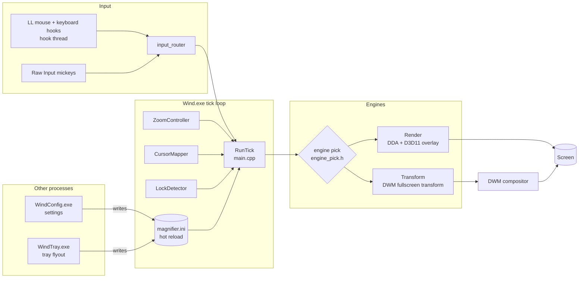

# Wind architecture

Developer documentation for Wind. The code is authoritative; specs and findings files are history.

## The system at a glance

One paced tick loop in `Wind.exe` reads input from hooks and Raw Input, turns it into a view with
pure mapper logic, and hands the view to one of two engines: Transform (the default) or Render.

There are two engines, Transform (the default) and Render. Auto, which switched between them per
window, was removed as an option in #508 ([03](03-engines.md)).

## Chapters

| # | Chapter | Covers |
|---|---------|--------|
| 01 | [Overview](01-overview.md) | Product rules, the three binaries, the pure/Win32 split, source map |
| 02 | [The tick loop](02-tick-loop.md) | `RunTick` phases, pacing, idle sleep, config hot-reload, threads |
| 03 | [Engines and the hybrid pick](03-engines.md) | The engine interface, the pick, handover, why Wind does not drive the built-in Magnifier |
| 04 | [The render engine](04-render-engine.md) | Capture, overlay, reveal gating, HDR, colour filters |
| 05 | [The transform engine](05-transform-engine.md) | The Magnification runtime, write channels and cadence, MPO, the input transform |
| 06 | [The input pipeline](06-input.md) | Hooks, swallowing, bind rules, safety nets, Raw Input limits |
| 07 | [The cursor system](07-cursor.md) | Mapper, weld, native cursor, lock detection, Inspect, tracking, keyboard panning |
| 08 | [Config and profiles](08-config-profiles.md) | The ini as IPC, parsing, hot vs restart, profiles, key reference |
| 09 | [The settings UI](09-settings-ui.md) | WebView2 host, bridge, schema, session model, themes, tests |
| 11 | [Build, test, release](11-build-test-release.md) | `build.bat`, the test split, deploy, installer, release and alpha workflows |
| 12 | [Instrumentation](12-instrumentation.md) | Logging, diagnostic knobs, measurement scripts |

There is no chapter 10: it covered the magnify engine, which was retired (#353), and the chapter
went with it (#358). The other chapters keep their numbers because CLAUDE.md and the chapters cite
them.

`CLAUDE.md` at the repo root holds the rules for coding agents and points here.

## Docs index

| File | What it is | State |
|---|---|---|
| [../VERIFICATION.md](../VERIFICATION.md) | Hands-on release checklist | Live |
| [../HITCH-FINDINGS.md](../HITCH-FINDINGS.md) | Transform hitching: the live-context tax, the pan-start hitch, engine configurations, zoom response | Open (#310) |
| [../TRACKING-FINDINGS.md](../TRACKING-FINDINGS.md) | Caret, focus and edge tracking per app | Live |
| [../COLOUR-FILTER-FINDINGS.md](../COLOUR-FILTER-FINDINGS.md) | Warmth and brightness: mechanism, HDR maths, rejected filters | Live |
| [../history/](../history/README.md) | Closed investigations: the built-in Magnifier stomp, pointer hit-testing, acrylic parity, shell panels | History |
| [../specs/](../specs/README.md) | Original design specs of shipped features | History (frozen) |
| `../design/` | Mockups the specs and code cite (`FINAL-v10-grey.html`, `j01-calm-tint.html`, `k01-sliders-toggles.html`) | History (frozen) |
| `../../tools/testenv/README.md` | The automated proving ground | Live |
| `../../installer/README.md` | The installer layout and build | Live |

Plans and open work are tracked in GitHub issues.
